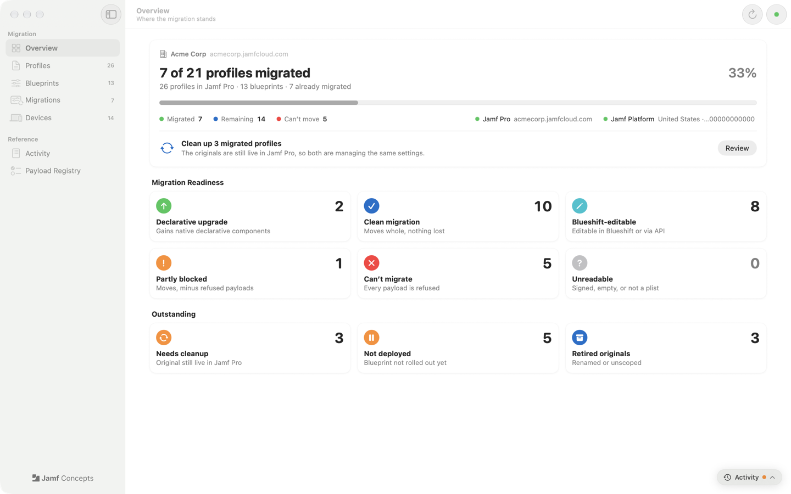
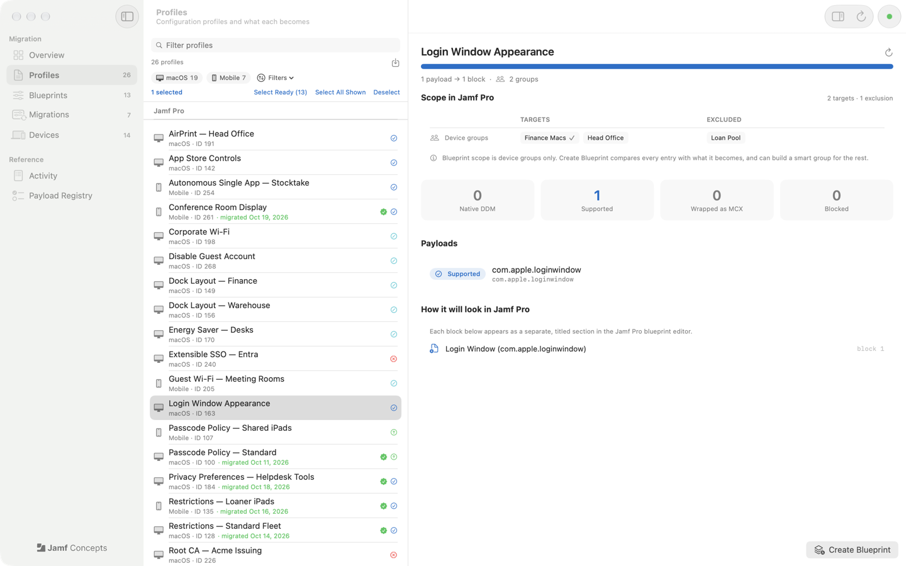
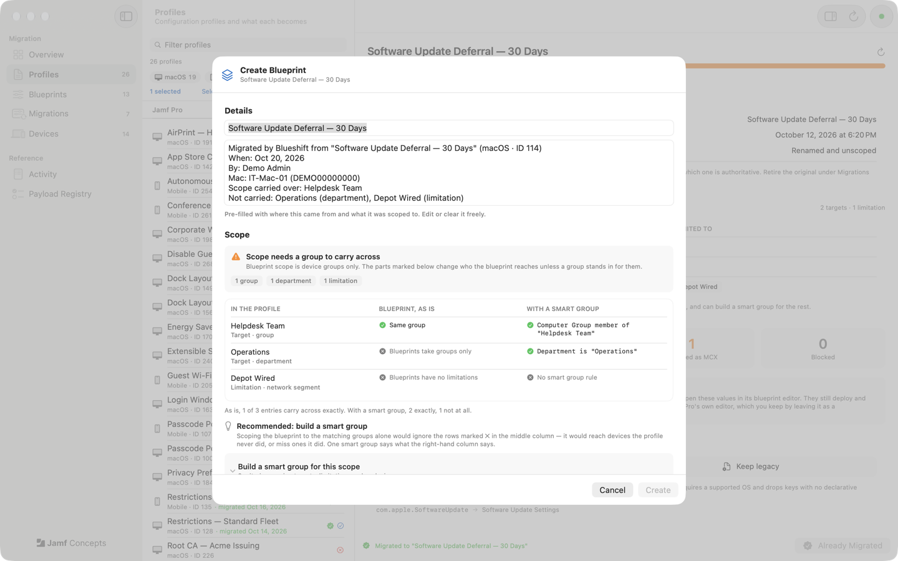
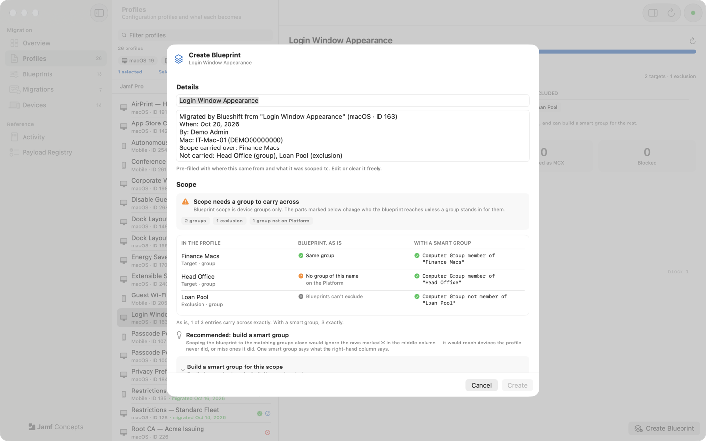
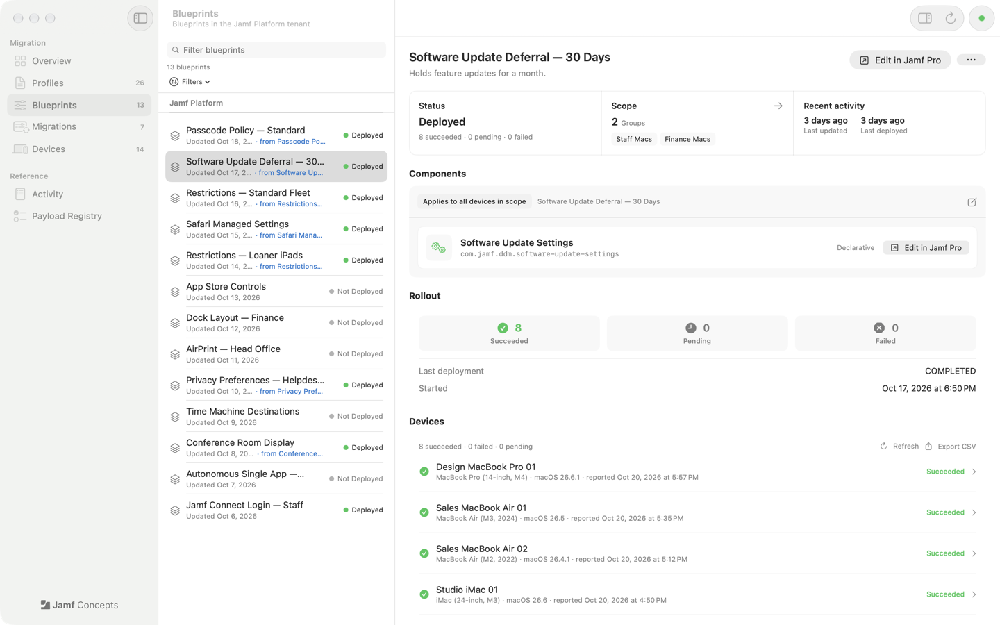
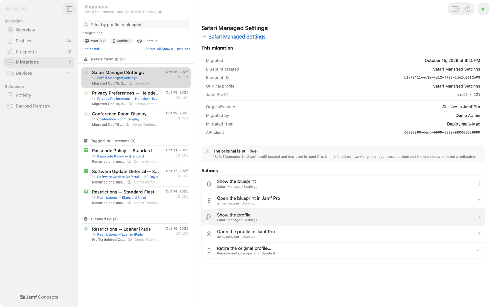
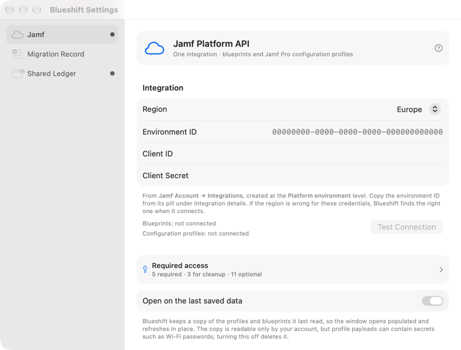

# Blueshift

> **This repository contains no source code.** It hosts documentation, release
> packages and the issue tracker for Blueshift. Compiled builds are published
> under [Releases](https://github.com/Jamf-Concepts/blueshift/releases).

Move Jamf Pro configuration profiles to Jamf Blueprints — and see exactly what
will happen *before* anything is sent.

Blueshift is a macOS app for Jamf admins. It reads your configuration profiles,
gives every payload a verdict, creates the blueprint through the Jamf Platform
API with the profile's scope carried across, and then helps you retire the
original so two things never manage the same settings.

> **A Jamf Concepts app** — that is what the yellow CONCEPTS ribbon on its icon
> means. Blueshift is not a supported Jamf product. It creates blueprints but
> never deploys them — deployment stays in Jamf Pro.

| | |
|---|---|
|  **Overview** — where the migration stands, and the next step. |  **Profiles** — every profile, its scope, and what each payload becomes. |
|  **Create Blueprint** — the scope compared line by line, with a recommendation. |  **Build a smart group** — one group that says what the whole scope said. |
|  **Blueprints** — scope, contents and per-device rollout. |  **Migrations** — what moved, and what is left to retire. |

More screenshots: [Devices](docs/screenshots/devices.png) ·
[Activity](docs/screenshots/activity.png) ·
[Payload Registry](docs/screenshots/registry.png) ·
[Help](docs/screenshots/help.png) ·
[Settings](docs/screenshots/settings-jamf.png) ·
[Migration Record](docs/screenshots/settings-record.png)

## What it does

- **Preview before sending.** Every payload gets a verdict — native declarative,
  supported, wrapped as managed preferences, or blocked — before anything
  reaches the API, so a blueprint never fails with an unexplained
  `VALIDATION_FAILURE`.
- **Migrate one or many.** macOS, iOS and iPadOS profiles, from Jamf Pro or a
  `.mobileconfig` on disk. Passcode, Safari, software-update and Rapid Security
  Response settings become native declarative components.
- **Carry the scope across.** Every target, limitation and exclusion is compared
  with what a blueprint can express, and Blueshift can build one smart group
  that covers the rest.
- **Retire the original.** Rename and unscope it (the default) or delete it, so
  the old profile stops managing the same settings.
- **Work as a team.** Every blueprint records who migrated it and which profile
  it replaced, so every admin sees the same picture.

## Install

1. Download `Blueshift-<version>.pkg` from
   [Releases](https://github.com/Jamf-Concepts/blueshift/releases).
2. Open it and follow the installer. Requires **macOS 14 or later**.

The package is signed and notarised by Apple. Credentials are stored in your
login keychain.

## Get started



Blueshift needs one **Jamf Account integration**. It reaches both the Jamf
Platform API and your Jamf Pro tenant through the Jamf API gateway — there is no
Jamf Pro API client or password to set up.

1. Sign in to **Jamf Account** (account.jamf.com). Your Jamf Pro tenant must be
   onboarded to the Jamf Platform.
2. Open **Integrations → Create integration**, set the level to **Platform
   environment**, and choose the environment your Jamf Pro is linked to.
3. Tick the permissions [below](#permissions) — at least the five marked
   **Required**.
4. Save, then copy the **client ID**, the **client secret** (shown once) and the
   **environment ID** (the environment pill under **Integration details**).
5. In Blueshift, open **Settings ▸ Jamf**, choose your region, paste the three
   values and click **Test Connection**. A wrong region is corrected
   automatically.

Then migrate:

1. **Profiles** — select a profile and review its verdicts and scope.
2. **Create Blueprint** — check the name, description and scope comparison;
   use the recommended groups or build a smart group; click **Create**.
3. **Migrations** — once the blueprint is proven, **Retire the original
   profile**.

Every screen is explained in the built-in Help (**Help ▸ Blueshift Help**, ⌘?).

## Permissions

Every permission is ticked on the same integration in Jamf Account. A missing
optional one only switches off the feature that needs it.

| Permission | Needed for | Endpoint |
|---|---|---|
| Configuration Profiles — Read | **Required.** Lists Mac and mobile profiles and reads their payloads | `GET proclassic/osxconfigurationprofiles`, `…/mobiledeviceconfigurationprofiles` |
| Blueprints — Read | **Required.** Lists blueprints, scope, components and settings | `GET blueprints/v1/blueprints` |
| Blueprints — Create | **Required.** The migration itself | `POST blueprints/v1/blueprints` |
| Blueprints — Update | **Required.** Scope, activation condition and payload values | `PATCH …/blueprints/{id}` |
| Device Groups — Read | **Required.** Scoping, and matching a profile's scope by name | `GET device-groups/v1/device-groups` |
| Configuration Profiles — Update | Retiring an original: rename, re-file, unscope | `PUT proclassic/…/id/{id}` |
| Categories — Read | Finding the **Migrated by Blueshift** category | `GET proclassic/categories` |
| Categories — Create | Creating that category the first time | `POST proclassic/categories/id/0` |
| Configuration Profiles — Delete | Optional — deleting an original outright | `DELETE proclassic/…/id/{id}` |
| Device Groups — Create | Optional — **Build a smart group** | `POST device-groups/v1/device-groups` |
| Jamf Pro Server URL — Read | Optional — **Open in Jamf Pro** links | `GET pro/v1/jamf-pro-server-url` |
| Computer Inventory — Read | Optional — records which Mac and user ran a migration | `GET pro/v1/computers-inventory` |
| Departments — Read | Optional — your department in blueprint descriptions | `GET pro/v1/departments/{id}` |
| Blueprints — Deploy | Optional — the Deploy and Undeploy buttons; migrating never deploys | `POST …/blueprints/{id}/deploy` |
| Blueprints — Delete | Optional — **Undo** straight after a migration | `DELETE …/blueprints/{id}` |
| Blueprint Components — Read | Optional — the declarative catalogue and OS minimums | `GET …/blueprint-components` |
| Devices — Read | Optional — device names in rollout reports | `GET devices/v1/devices` |
| Declarations Reporting — Read | Optional — per-device rollout status | `GET ddm/report/v1/…` |
| Activation Code — Read | Optional — the organisation name beside the connection | `GET proclassic/activationcode` |

The same list, with a **Copy Permission List** button, is behind the **?** in
**Settings ▸ Jamf**.

## Troubleshooting

| Symptom | What to do |
|---|---|
| `invalid_client` in every region | The client ID or secret is wrong, or a Jamf Pro API client was pasted in. Create the integration in Jamf Account at the **Platform environment** level. |
| `REQUEST_CONTEXT_NOT_PROVIDED` or an environment error | The environment ID is missing or wrong. Copy it from the environment pill under **Integration details**. |
| `403 BAD_PERMISSIONS` on one feature | The integration lacks that permission. Add it in Jamf Account, wait a minute or two, then **Reconnect**. |
| A blueprint fails with `VALIDATION_FAILURE` | Open **Payload Registry → Re-check against this tenant** and migrate again. If the API names a missing key, Blueshift offers to re-send that payload as managed preferences. |
| A profile shows as **Unreadable** | It is signed, empty or not a property list. Export it unsigned and drag it in. |
| Blueprint scope will not save | Every blueprint needs at least one device group — the Platform API refuses an empty scope. |

More answers: [FAQ](docs/FAQ.md).

## Logging

Blueshift writes to the macOS unified log under the subsystem
`com.blueshift.app`, with categories such as `connection`, `profiles`,
`blueprints`, `migration` and `network`. **Window ▸ Blueshift Log Console**
(⇧⌘L) shows it live inside the app, with filters and export. From a terminal:

```bash
log show --predicate 'subsystem == "com.blueshift.app"' --info --last 1h
log stream --predicate 'subsystem == "com.blueshift.app"' --level debug
```

In Console.app, search for `subsystem:com.blueshift.app`. Request logs record
method, path, status, timing and size — never bodies or credentials.

## Known gaps

- **Every blueprint needs at least one device group.** The Platform API refuses
  an empty scope, although Jamf Pro's own editor allows it.
- **Network segments, iBeacons and user groups** in a profile's scope cannot be
  expressed as blueprint scope or smart group criteria; Blueshift lists them so
  you can decide.
- **A blueprint with no components cannot be edited through the API.** Add its
  contents in Jamf Pro first.

## More

- [How Blueshift works](docs/HOW-IT-WORKS.md) — verdicts, readiness, scope and
  smart groups, retiring originals, working as a team
- [FAQ](docs/FAQ.md)
- [Windows users](docs/WINDOWS.md) — the same migration with jamf-cli

## Dependencies and Software Bill of Materials

Blueshift uses Apple system frameworks (SwiftUI, AppKit, Foundation,
Security, OSLog, IOKit, CryptoKit) and one third-party package, pulled in via
Swift Package Manager:

| Package | Version | License | Home repository | License file |
| --- | --- | --- | --- | --- |
| TelemetryDeck SwiftSDK | 2.14.2 | MIT | [github](https://github.com/TelemetryDeck/SwiftSDK) | [LICENSE](https://github.com/TelemetryDeck/SwiftSDK/blob/main/LICENSE) |

See [Privacy](#privacy) for what it reports and how to turn it off.

## Network and data

Blueshift talks only to the Jamf API gateway for your region
(`{us|eu|apac}.api.jamfcloud.com`) and, for declarative schemas, Apple's public
`device-management` repository on GitHub, plus the one anonymous launch signal
described under [Privacy](#privacy). Credentials stay in your login keychain and
logs stay on the Mac.

## Privacy

We use TelemetryDeck to know how often the app is opened. That helps us decide
if we should keep working on the idea. The information is anonymous: nothing
about your tenant, profiles, blueprints or devices is sent.

To turn it off, open **Blueshift ▸ Settings ▸ Jamf** and enable **Opt out of
analytics**. It takes effect from the next launch.

See [Jamf's Privacy Policy](https://www.jamf.com/trust-center/privacy/privacy-policy/)
for information on data handling.

## Where to get help

If you encounter a bug or have a feature request, please open an issue via
[GitHub Issues](https://github.com/Jamf-Concepts/blueshift/issues). Release notes
are in [GitHub Releases](https://github.com/Jamf-Concepts/blueshift/releases).
For more information about Jamf Concepts, please see the
[Jamf Concepts website](https://concepts.jamf.com).

## Terms of Use

This project is offered under the
[Jamf Concepts Use Agreement](https://resources.jamf.com/documents/jamf-concept-projects-use-agreement.pdf).
For information on how Jamf handles personal data, please see the
[Jamf Privacy Policy](https://jamf.com/privacy).

*Copyright 2026, Jamf Software LLC*
